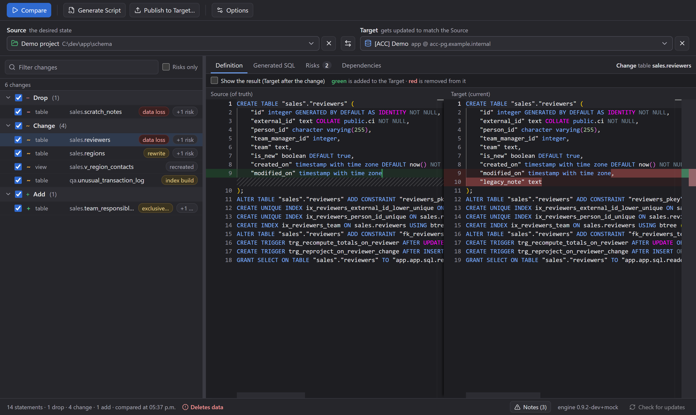
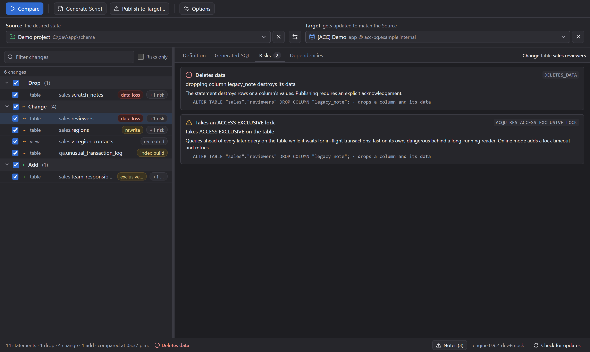
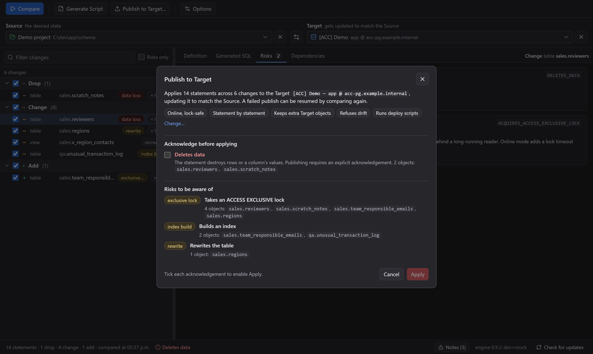
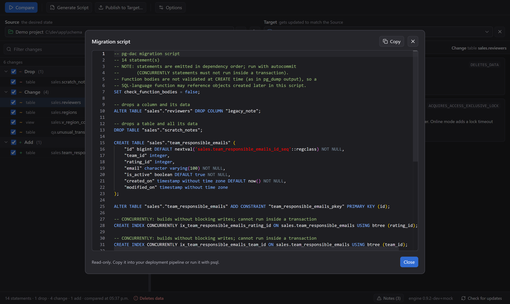

# pg-dac

[](https://github.com/rmnunes/pg-dac/actions/workflows/ci.yml)
[](https://github.com/rmnunes/pg-dac/releases/latest)
[](LICENSE)

**Schema compare and deployment for PostgreSQL, the way SQL Server's DACPAC and SqlPackage work.**

Point pg-dac at the schema you want (a folder of `.sql` files, a packaged `.pgdac` artifact or
another database) and at the database to update. It shows every difference object by object,
explains the risk of each change, and writes a migration that runs in the right order without
locking your tables longer than it has to. You review it, then publish.



## Highlights

- **Compare anything with anything.** A live database, a project folder, a `.sql` file or a
  `.pgdac` artifact, on either side, including an empty database.
- **Migrations you can trust.** Statements are ordered by real dependencies; views and triggers
  in the way are dropped and recreated automatically; indexes are built `CONCURRENTLY` and
  constraints added `NOT VALID` first.
- **Safe by default.** Every statement is checked for risks (data loss, exclusive locks, table
  rewrites). Data loss is refused unless you acknowledge it, and drift on the target since the
  last publish is detected.
- **Portable, signed artifacts.** `pg-dac build` packages a schema into a `.pgdac` file, signed
  so a pipeline can check where it came from, the PostgreSQL counterpart of a `.dacpac`.
- **A desktop app and a CLI.** Visual Schema Compare for people; one binary for pipelines.

## Install

**Desktop app:** download the installer for your system from the
[latest release](https://github.com/rmnunes/pg-dac/releases/latest): `pg-dac_<version>_x64-setup.exe`
(Windows), `pg-dac_<version>_aarch64.dmg` (macOS, Apple silicon), or the `.deb`, `.rpm` or `.AppImage`
(Linux). The app updates itself when a new version is released.

> The installers are not code-signed yet. Windows SmartScreen asks for confirmation (*More info →
> Run anyway*), and macOS may refuse to open the app until you clear the download flag:
> `xattr -dr com.apple.quarantine /Applications/pg-dac.app`.

**CLI:** download `pg-dac-<platform>` from the same release, rename it to `pg-dac` (`pg-dac.exe` on
Windows), put it on your `PATH` and check it against `SHA256SUMS.txt`. Or build it with Go 1.25+:

```bash
go install github.com/rmnunes/pg-dac/cmd/pg-dac@latest
```

PostgreSQL 11 to 18 is supported as a target. Nothing else is needed: pg-dac normalizes both sides
of a comparison in a private, throwaway PostgreSQL, which the first compare downloads once and
caches.

## Quick start

```bash
# Turn an existing database into a project: one file per object.
pg-dac extract --from "postgres://app@localhost/app" --to-project ./schema

# Edit the files, then see what would change in a target database.
# --to is the state you want, --from is the database that gets updated.
pg-dac diff    --from "postgres://app@staging/app" --to ./schema

# Review the migration script, then apply it.
pg-dac script  --from "postgres://app@staging/app" --to ./schema > migrate.sql
pg-dac publish --from "postgres://app@staging/app" --to ./schema
```

Keep passwords out of connection strings: pg-dac reads `PGPASSWORD` and `~/.pgpass` like `psql`
does. Try it on a copy or a non-production database first. [docs/cli.md](docs/cli.md) has every
command and option.

## The desktop app

Pick a Source and a Target, press **Compare**, and review the result like SSDT's Schema Compare.
Each change shows its definition diff, the SQL that will run, its risks and its dependencies;
untick what you don't want to deploy.

| Risks, explained per change | Publishing asks before anything destructive |
|---|---|
|  |  |

**Generate Script** gives you the whole migration to review or hand to your deployment pipeline:



## Coming from SQL Server?

| SSDT / SqlPackage | pg-dac |
|---|---|
| SQL Database Project | A project folder with `pgdac.yaml` (`pg-dac init`, `pg-dac extract --to-project`) |
| `.dacpac` | `.pgdac` (`pg-dac build`, `pg-dac extract --out`) |
| `.bacpac` (schema and data) | `.pgbac` (`pg-dac export`, `pg-dac import`) |
| `/Action:Publish` | `pg-dac publish` |
| `/Action:Script`, `/Action:DeployReport` | `pg-dac script`, `pg-dac report` |
| Schema Compare | `pg-dac diff`, or the desktop app |
| Update project from database | `pg-dac publish --from ./schema --to <database>` |
| Refactor log, pre/post-deploy scripts, SQLCMD variables | `refactorlog.json`, `preDeploy`/`postDeploy`, `--var name=value` |
| `/p:BlockOnPossibleDataLoss`, `/p:DropObjectsNotInSource`, `/p:ExcludeObjectTypes` | On by default, `--drop-objects-not-in-source`, `--exclude-object-type` |
| Target platform, `/p:AllowIncompatiblePlatform` | `targetMajor` in `pgdac.yaml` or `--target-major`, `--allow-incompatible-platform` |

## Documentation

- [docs/cli.md](docs/cli.md): every command, the comparison options, projects and artifacts.
- [ROLLOUT.md](ROLLOUT.md): running pg-dac in a delivery pipeline, per environment.
- [docs/how-it-works.md](docs/how-it-works.md): the model, the planner, what is managed and how it is tested.
- [docs/UPDATES.md](docs/UPDATES.md): how the desktop app updates itself.
- [ui/README.md](ui/README.md): the desktop app's architecture and how to develop it.
- [STATUS.md](STATUS.md) and [CHANGELOG.md](CHANGELOG.md): what is done, what is not, and what changed.

## Status

pg-dac is a release candidate on the way to 1.0. CI runs the full test suite on every supported
PostgreSQL major, 11 to 18, and it has been exercised against a production schema of about 900
objects. Ownership, default privileges and roles are not
managed (roles must exist), and a few changes PostgreSQL cannot make in place, such as removing an
enum value, are reported instead of applied. See [STATUS.md](STATUS.md) for the details.

## Contributing

Bug reports, ideas and pull requests are welcome. [CONTRIBUTING.md](CONTRIBUTING.md) explains how
to build, test and propose a change. Please report security issues privately as described in
[SECURITY.md](SECURITY.md), and follow the [code of conduct](CODE_OF_CONDUCT.md).

## License

Apache-2.0. The dependency-ordering algorithm is reimplemented from PostgreSQL's `pg_dump_sort.c`
(BSD) and the hazard rules from the PostgreSQL docs and Squawk (concepts only); no GPL code is
copied.
